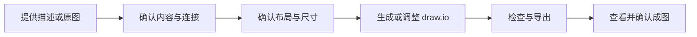

<div align="center">

# Scientific draw.io Flowchart

**制作可编辑的科研流程图，将已有图适配到目标版面尺寸，并检查内容与连接是否保持一致。**


从流程描述到可编辑文件，从原有版式到目标版面，让科研流程图更方便制作、修改和交付。

**[English](README.md) · 简体中文**

</div>

## 📑 目录

- [效果预览](#效果预览)
- [为什么使用这个 Skill](#为什么使用这个-skill)
- [你可以用它做什么](#你可以用它做什么)
- [安装与首次使用](#安装与首次使用)
- [将已有流程图适配到目标尺寸](#将已有流程图适配到目标尺寸)
- [完整案例](#完整案例)
- [工作流程与交付文件](#工作流程与交付文件)
- [进阶使用](#进阶使用)
- [许可证](#许可证)

<a id="效果预览"></a>

## 🖼️ 效果预览

### 同一张流程图，适配不同版面

已有流程图需要适配期刊或其他使用场景的尺寸要求时，可以在保留节点内容和连接关系的基础上，重新安排布局、换行、间距和连线。

以下以 **86 mm 宽、高度不超过 210 mm 的单栏版式**为例，展示一次完整的尺寸适配过程。

<table>
<tr><th>原始版式</th><th>尺寸适配示例：86 mm 单栏</th></tr>
<tr>
<td width="65%" align="center"></td>
<td width="35%" align="center"></td>
</tr>
</table>

| 项目 | 适配结果 |
|---|---|
| 目标宽度 | **86 mm** |
| 高度上限 | **210 mm** |
| 最终 SVG 尺寸 | **86 × 177.042 mm** |
| 流程结构 | 保留 9 个节点、9 条连接 |
| 版式调整 | 节点位置、框体尺寸、文字换行、间距与连线路径 |
| 交付文件 | 可继续编辑的 `.drawio` 文件、SVG 成图及检查结果 |

可以继续在 draw.io 中修改图形，也可以使用导出的 SVG 排版。

<a id="为什么使用这个-skill"></a>

## 💡 为什么使用这个 Skill

科研流程图既需要清楚呈现研究步骤，也需要适应具体的版面要求。完成初稿后，仍可能因为投稿规范、栏宽或排版安排而需要调整尺寸。

直接缩放会同时改变文字和图形的大小；重新安排布局，则需要核对分支、汇合和排除路径，确保流程关系保持一致。

`scientific-drawio-flowchart` 将这些工作组织为一套可复用的流程：

**确定内容与连接 → 设计布局 → 生成可编辑文件 → 按目标尺寸调整 → 检查并导出。**

无论是首次制作，还是修改已有图，都可以沿着这套流程完成。

| 功能 | 带来的便利 |
|---|---|
| 先确认流程，再制作图形 | 在排版前明确步骤、分支和汇合关系 |
| 生成可编辑的 draw.io 文件 | 保留节点、文字和连接，方便后续修改 |
| 按目标尺寸重新排版 | 围绕宽高要求调整布局、字号、换行与间距 |
| 比较修改前后的内容与连接 | 调整版式时同步核对流程关系 |
| 检查并导出成图 | 核对结构、几何和最终 SVG 尺寸，完成交付 |

<a id="你可以用它做什么"></a>

## ✨ 你可以用它做什么

### ① 把研究流程描述变成可编辑的流程图

提供方法描述、步骤列表或已有流程草稿，让 AI 助手先整理节点和连接关系，再生成图形。

```text
使用 $scientific-drawio-flowchart 制作一张研究流程图。

根据以下研究步骤，先整理节点、分支和汇合关系，
列出需要确认的问题，再提出布局方案。

确认后生成可编辑的 draw.io 文件，并导出 SVG。

研究步骤：
……
```

适合整理样本处理、纳入排除、实验步骤和数据分析等流程。

### ② 把已有流程图调整到指定尺寸

提供原始 `.drawio` 文件和目标尺寸，在现有内容基础上重新排版。

```text
使用 $scientific-drawio-flowchart，
将附件中的流程图调整为宽度 86 mm、高度不超过 210 mm。

保留节点文字、数字和连接关系，
允许调整节点位置、框体大小、文字换行和连线路径。

请先提供布局与字号方案，
确认后另存新版本，并检查最终 SVG 的实际尺寸。
```

将示例中的宽高替换为实际要求，即可用于其他目标版面。

### ③ 检查流程图中的连接与排版问题

检查分支、终点、汇合路径、节点重叠和越界情况；提供原始版本后，还可以比较修改前后的内容与连接。

```text
使用 $scientific-drawio-flowchart 检查附件中的流程图。

请核对分支与汇合关系、排除节点是否仍有后续连接，
以及节点重叠、文字排版和页面边界。

先报告发现的问题，再给出修改建议。
```

<a id="安装与首次使用"></a>

## 🚀 安装与首次使用

### 1. 准备工具

| 工具 | 用途 |
|---|---|
| Codex | 读取 Skill，协助设计和修改流程图 |
| Python | 运行配套的生成与检查脚本 |
| draw.io / diagrams.net | 打开、编辑和导出流程图 |

### 2. 安装 Skill

下载本仓库，将包含 `SKILL.md` 的完整文件夹放到个人 Skills 目录：

```text
~/.agents/skills/scientific-drawio-flowchart/
```

Windows 路径示例：

```text
C:\Users\<用户名>\.agents\skills\scientific-drawio-flowchart\
```

安装后的目录应包含：

```text
scientific-drawio-flowchart/
├── SKILL.md
├── agents/
├── references/
├── scripts/
└── tests/
```

### 3. 开始第一次绘图

在 Codex 中输入：

```text
使用 $scientific-drawio-flowchart 制作一张科研流程图。

流程内容：
导入 100 条记录，排除 20 条；
其余 80 条进入质量检查，
其中 60 条完整、10 条修复后可用、10 条不可用；
将完整和修复后可用的记录汇合，
最终 70 条进入分析。

请先提交流程结构与布局方案供确认，
确认后生成可编辑的 draw.io 文件，并导出 SVG。
```

AI 助手会整理流程、提出布局方案，并在确认后生成文件。

完成后，打开 `.drawio` 文件可以继续修改节点、文字和连线；打开 SVG 可以查看导出效果并用于排版。

<a id="将已有流程图适配到目标尺寸"></a>

## 📐 将已有流程图适配到目标尺寸

准备以下信息，就可以开始调整：

| 提供什么 | 示例 |
|---|---|
| 原始文件 | `workflow.drawio` |
| 目标宽度 | 86 mm |
| 高度上限 | 210 mm |
| 导出格式 | SVG |
| 字号要求 | 指定最小字号，或请助手先提出方案 |
| 修改要求 | 保留文字、数字和连接关系，允许调整布局与换行 |

### ① 确认原图

读取节点、文字和连接关系，明确需要保留的内容，以及允许调整的项目。

### ② 确认适配方案

结合目标尺寸，安排布局方向、节点宽度、字号、换行、间距和连线路径。

### ③ 生成新版本

保留原文件，另存适配后的 `.drawio` 文件，并比较修改前后的内容与连接。

### ④ 导出与检查

导出 SVG，核对实际宽高，查看文字、连线和整体排版，交付成图与检查结果。

> 💬 **可以直接这样说**
>
> “将附件中的流程图调整为指定宽度和高度上限。保留原有内容和连接，先提供布局方案，确认后生成新版本，并核对导出文件的实际尺寸。”

<a id="完整案例"></a>

## 🔎 完整案例

### 从样本处理描述到单栏流程图

这个示例使用一组完全合成的数据：

| 处理阶段 | 数量与去向 |
|---|---|
| 导入记录 | 100 条 |
| 初步排除 | 20 条，流程结束 |
| 进入质量检查 | 80 条 |
| 数据完整 | 60 条 |
| 修复后可用 | 10 条 |
| 不可用 | 10 条，流程结束 |
| 汇合并进入分析 | 70 条 |

首先生成可编辑的流程图，再将原有版式调整为 **86 mm 宽、高度不超过 210 mm** 的单栏图。

完成后，核对了以下结果：

| 检查项目 | 结果 |
|---|---|
| 节点与连接 | 保留 9 个节点、9 条连接 |
| 节点内容 | 保留原有文字与数字，并调整两处文字换行 |
| 分支与汇合 | 排除路径、质量检查分支及分析汇合关系保持一致 |
| 图形结构与几何 | 检查通过 |
| 最终 SVG 尺寸 | 86 × 177.042 mm |
| 成图查看 | 已查看实际导出效果 |
| 后续修改 | 可继续编辑 `.drawio` 文件 |

📂 **下载案例文件：** [原始流程图](examples/synthetic-records/original.drawio) · [86 mm 适配版](examples/synthetic-records/adapted-86mm.drawio) · [SVG 成图](assets/workflow-86mm.svg)

📂 **案例复核材料：** [原图规格](examples/synthetic-records/original.spec.json) · [适配版规格](examples/synthetic-records/adapted-86mm.spec.json) · [适配版原始 SVG 导出](examples/synthetic-records/adapted-raw.svg)

### 定位一条错误连接

演示中还制作了一个错误版本：把“不可用记录”连接到后续汇合节点。


检查定位了这条错误连接，并指出：

- 连接起点发生变化；
- 排除终点出现了后续连接；
- 原本需要保留的路径缺失；
- 节点的连接数量与预期不一致。

调整节点位置、分支布局或连线路径后，可以使用这类检查重新核对关键流程关系。

📂 [下载错误连接示例](examples/synthetic-records/wrong-connection.drawio)

<a id="工作流程与交付文件"></a>

## 📦 工作流程与交付文件



使用者确认研究内容、版式要求和最终效果；AI 助手组织流程、设计布局，并调用配套脚本完成生成与检查。

一次任务通常会得到：

| 文件 | 用途 |
|---|---|
| `.drawio` | 保存节点、文字和连线，方便继续编辑 |
| `.svg` | 用于查看、排版和后续图形处理 |
| 流程规格文件 | 记录节点、连接及布局信息 |
| 检查结果 | 查看内容比较、结构和尺寸检查情况 |

对于已有图的尺寸修改，会保留原始版本，并另存调整后的文件，方便对照与继续修改。

<a id="进阶使用"></a>

## 🛠️ 进阶使用

需要更精细地控制流程、布局或检查方式时，可以查看：

- [流程规格](references/flowchart-spec.md)：定义节点、连接、布局和出版尺寸要求。
- [布局与文字排版](references/layout-and-typography.md)：安排节点尺寸、文字换行和间距。
- [已有图尺寸适配](references/resize-existing.md)：按目标版面调整已有流程图。
- [检查与导出](references/validation-and-export.md)：组织检查并完成成图交付。

<details>
<summary><strong>查看配套脚本</strong></summary>

| 脚本 | 用途 |
|---|---|
| `build_drawio.py` | 根据流程规格生成可编辑的 draw.io 文件 |
| `validate_drawio.py` | 检查流程结构与几何问题 |
| `compare_flowcharts.py` | 比较两个版本的节点内容与连接关系 |
| `normalize_svg_size.py` | 设置 SVG 的物理尺寸，支持按比例计算高度 |
| `check_svg_size.py` | 核对 SVG 宽高、比例和字号声明 |

</details>

<a id="许可证"></a>

## 📄 许可证

本项目采用 [MIT License](LICENSE)。
