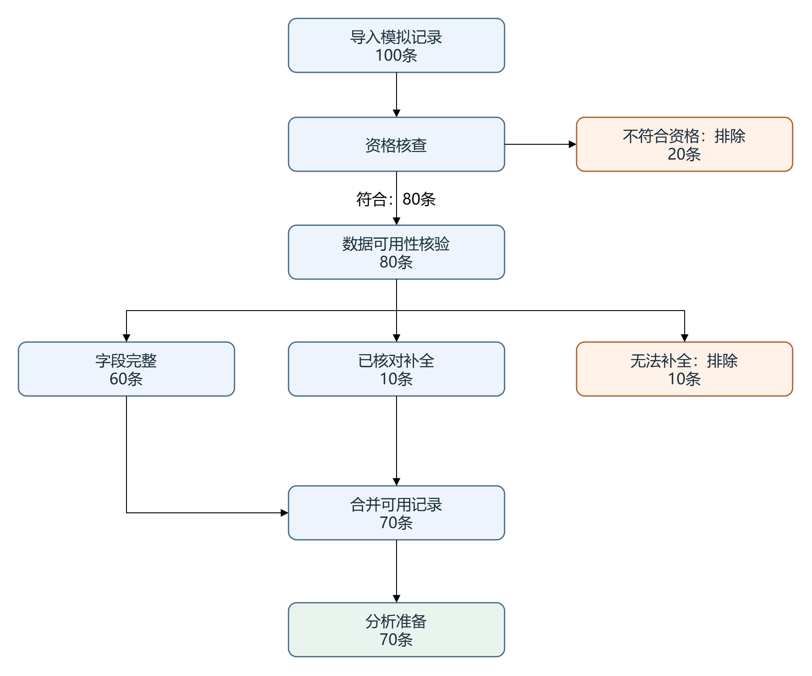
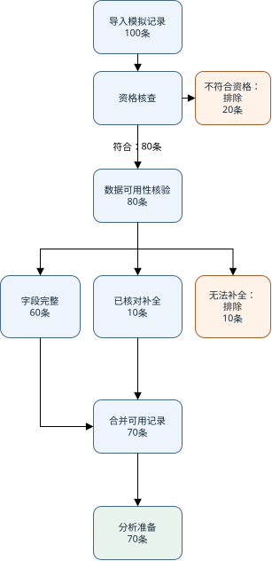
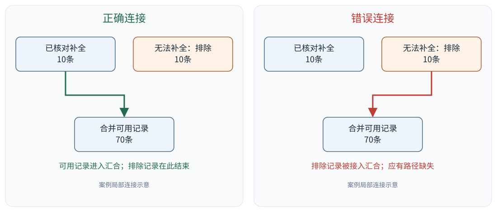
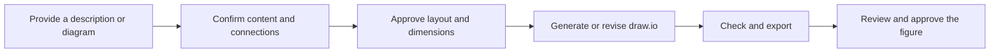

<div align="center">

# Scientific draw.io Flowchart

**Create editable scientific flowcharts, adapt existing diagrams to target dimensions, and check that their content and connections stay consistent.**


Turn workflow descriptions into editable diagrams, and reshape existing layouts for publication and other uses.

**English · [简体中文](README-ZH.md)**

</div>

## 📑 Contents

- [Preview](#preview)
- [Why use this Skill?](#why-use-this-skill)
- [What you can do](#what-you-can-do)
- [Installation and first use](#installation-and-first-use)
- [Adapt an existing flowchart to target dimensions](#adapt-an-existing-flowchart-to-target-dimensions)
- [Worked example](#worked-example)
- [Workflow and deliverables](#workflow-and-deliverables)
- [Advanced use](#advanced-use)
- [License](#license)

<a id="preview"></a>

## 🖼️ Preview

### One flowchart, different layouts

When a flowchart needs to meet a journal's dimensions or fit another format, adjust its layout, line breaks, spacing, and connector routes while preserving node content and connections.

The example below demonstrates adaptation to a **single-column layout, 86 mm wide and no more than 210 mm tall**.

<table>
<tr><th>Original layout</th><th>Example: 86 mm single-column layout</th></tr>
<tr>
<td width="65%" align="center"></td>
<td width="35%" align="center"></td>
</tr>
</table>

| Item | Result |
|---|---|
| Target width | **86 mm** |
| Maximum height | **210 mm** |
| Final SVG dimensions | **86 × 177.042 mm** |
| Workflow structure | All 9 nodes and 9 connections preserved |
| Layout changes | Node positions, box sizes, line breaks, spacing, and connector routes |
| Deliverables | Editable `.drawio` file, exported SVG, and check results |

Continue editing the diagram in draw.io, or use the exported SVG in your document layout.

<a id="why-use-this-skill"></a>

## 💡 Why use this Skill?

Scientific flowcharts need to communicate research steps clearly and fit their intended page layout. Even after the first draft is complete, submission guidelines, column widths, or typesetting decisions may require changes to its dimensions.

Scaling a diagram changes both its text and graphics. Rearranging its layout calls for checking branches, merges, and exclusion paths to keep the workflow consistent.

`scientific-drawio-flowchart` brings these tasks into a reusable process:

**Confirm content and connections → Design the layout → Generate an editable file → Adapt to target dimensions → Check and export.**

Use the same process to create a new diagram or revise an existing one.

| Feature | How it helps |
|---|---|
| Confirm the workflow before drawing | Clarify steps, branches, and merges before arranging the diagram |
| Generate editable draw.io files | Keep nodes, text, and connections available for later changes |
| Rework the layout for target dimensions | Adjust layout, font sizes, line breaks, and spacing around width and height requirements |
| Compare content and connections across versions | Check workflow relationships as the layout changes |
| Check and export the finished diagram | Review structure, geometry, and final SVG dimensions before delivery |

<a id="what-you-can-do"></a>

## ✨ What you can do

### ① Turn a research workflow description into an editable flowchart

Provide a methods description, a list of steps, or an existing workflow outline. The assistant organizes the nodes and connections before creating the diagram.

```text
Use $scientific-drawio-flowchart to create a research flowchart.

Based on the research steps below, first organize the nodes,
branches, and merges. List any questions that need clarification,
then propose a layout.

After approval, generate an editable draw.io file and export an SVG.

Research steps:
...
```

Use it for sample processing, inclusion and exclusion, experimental procedures, and data analysis workflows.

### ② Adapt an existing flowchart to specified dimensions

Provide the original `.drawio` file and target dimensions to rework its layout around the existing content.

```text
Use $scientific-drawio-flowchart to adapt the attached flowchart
to a width of 86 mm and a maximum height of 210 mm.

Preserve node text, numbers, and connections.
You may adjust node positions, box sizes, line breaks,
and connector routes.

First propose a layout and font sizes.
After approval, save a new version and check the final SVG's
physical dimensions.
```

Replace the example dimensions with the requirements of your target layout.

### ③ Check connections and layout

Review branches, terminal nodes, merge paths, overlapping nodes, and page bounds. With an original version available, compare content and connections before and after editing.

```text
Use $scientific-drawio-flowchart to check the attached flowchart.

Review branches and merges, whether excluded records have any
outgoing connections, node overlaps, text layout, and page bounds.

Report the findings first, then suggest changes.
```

<a id="installation-and-first-use"></a>

## 🚀 Installation and first use

### 1. Prepare the tools

| Tool | Purpose |
|---|---|
| Codex | Load the Skill and help design and revise flowcharts |
| Python | Run the generation and checking scripts |
| draw.io / diagrams.net | Open, edit, and export flowcharts |

### 2. Install the Skill

Download this repository and place the complete folder containing `SKILL.md` in your personal Skills directory:

```text
~/.agents/skills/scientific-drawio-flowchart/
```

Example Windows path:

```text
C:\Users\<username>\.agents\skills\scientific-drawio-flowchart\
```

The installed folder should contain:

```text
scientific-drawio-flowchart/
├── SKILL.md
├── agents/
├── references/
├── scripts/
└── tests/
```

### 3. Create your first flowchart

Enter this prompt in Codex:

```text
Use $scientific-drawio-flowchart to create a scientific flowchart.

Workflow:
Import 100 records and exclude 20.
The remaining 80 undergo a quality check:
60 are complete, 10 are usable after repair, and 10 are unusable.
Merge the complete and repaired records,
then send the resulting 70 records to analysis.

First present the workflow structure and proposed layout for approval.
After approval, generate an editable draw.io file and export an SVG.
```

The assistant organizes the workflow, proposes a layout, and generates the files after approval.

Open the `.drawio` file to continue editing nodes, text, and connectors. Open the SVG to review the exported figure and use it in your document.

<a id="adapt-an-existing-flowchart-to-target-dimensions"></a>

## 📐 Adapt an existing flowchart to target dimensions

Provide the following information to get started:

| Input | Example |
|---|---|
| Original file | `workflow.drawio` |
| Target width | 86 mm |
| Maximum height | 210 mm |
| Export format | SVG |
| Font size requirements | Specify a minimum font size, or ask the assistant to propose one |
| Editing requirements | Preserve text, numbers, and connections; allow layout and line-break changes |

### ① Confirm the original diagram

Review its nodes, text, and connections. Establish what to preserve and what may change.

### ② Approve the adaptation plan

Plan the layout direction, node widths, font sizes, line breaks, spacing, and connector routes around the target dimensions.

### ③ Generate a new version

Keep the original file, save the adapted `.drawio` separately, and compare content and connections across the two versions.

### ④ Export and check

Export the SVG, check its physical width and height, and review text, connectors, and overall layout before delivering the figure and check results.

> 💬 **Try this prompt**
>
> “Adapt the attached flowchart to the specified width and maximum height. Preserve its content and connections. Propose a layout first, then generate a new version after approval and check the exported file's physical dimensions.”

<a id="worked-example"></a>

## 🔎 Worked example

### From a record-processing description to a single-column flowchart

This example uses entirely synthetic data:

| Stage | Count and destination |
|---|---|
| Imported records | 100 |
| Initially excluded | 20; workflow ends |
| Proceed to quality check | 80 |
| Complete records | 60 |
| Usable after repair | 10 |
| Unusable records | 10; workflow ends |
| Merged and sent to analysis | 70 |

An editable flowchart was generated first, then adapted to a single-column layout **86 mm wide and no more than 210 mm tall**.

The completed diagram was checked with these results:

| Check | Result |
|---|---|
| Nodes and connections | All 9 nodes and 9 connections preserved |
| Node content | Original text and numbers preserved; line breaks adjusted in two labels |
| Branches and merges | Exclusion paths, quality-check branches, and the analysis merge preserved |
| Structure and geometry | Checks passed |
| Final SVG dimensions | 86 × 177.042 mm |
| Visual review | Actual exported figure reviewed |
| Further editing | Available in the `.drawio` file |

📂 **Download the example files:** [Original flowchart](examples/synthetic-records/original.drawio) · [86 mm adaptation](examples/synthetic-records/adapted-86mm.drawio) · [Exported SVG](assets/workflow-86mm.svg)

📂 **Reproduce the checks:** [Original specification](examples/synthetic-records/original.spec.json) · [Adapted specification](examples/synthetic-records/adapted-86mm.spec.json) · [Raw SVG export of the adapted layout](examples/synthetic-records/adapted-raw.svg)

### Locate an incorrect connection

A second version deliberately connects the unusable records to the downstream merge node.



The checks locate this connection and identify:

- A changed source node for the connection;
- An outgoing connection from an exclusion terminal;
- A missing required path;
- Node connection counts that differ from the expected values.

Use these checks to revisit key workflow relationships after moving nodes, rearranging branches, or changing connector routes.

📂 [Download the incorrect-connection example](examples/synthetic-records/wrong-connection.drawio)

<a id="workflow-and-deliverables"></a>

## 📦 Workflow and deliverables



The user confirms the research content, layout requirements, and final appearance. The assistant organizes the workflow, designs the layout, and runs the supporting generation and checking scripts.

A task typically produces:

| File | Purpose |
|---|---|
| `.drawio` | Keep nodes, text, and connectors editable |
| `.svg` | View the figure, place it in a document, or continue graphics editing |
| Workflow specification | Record nodes, connections, and layout information |
| Check results | Review content comparisons, structure checks, and dimension checks |

When adapting an existing diagram, the original is preserved and the revised diagram is saved separately for comparison and further editing.

<a id="advanced-use"></a>

## 🛠️ Advanced use

For more control over the workflow, layout, or checks, see:

- [Workflow specification](references/flowchart-spec.md): Define nodes, connections, layout, and publication dimensions.
- [Layout and typography](references/layout-and-typography.md): Plan node sizes, line breaks, and spacing.
- [Adapt existing diagrams](references/resize-existing.md): Rework an existing flowchart for a target layout.
- [Validation and export](references/validation-and-export.md): Organize checks and deliver the finished figure.

<details>
<summary><strong>Supporting scripts</strong></summary>

| Script | Purpose |
|---|---|
| `build_drawio.py` | Generate an editable draw.io file from a workflow specification |
| `validate_drawio.py` | Check workflow structure and geometry |
| `compare_flowcharts.py` | Compare node content and connections across two versions |
| `normalize_svg_size.py` | Set physical SVG dimensions, with proportional height calculation |
| `check_svg_size.py` | Check SVG width, height, aspect ratio, and declared font sizes |

</details>

<a id="license"></a>

## 📄 License

This project is licensed under the [MIT License](LICENSE).
